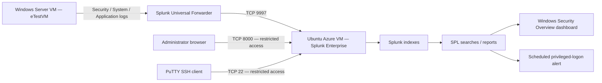

# Splunk SIEM & Windows Event Log Monitoring — Azure Lab

   

## Project overview

This hands-on security engineering lab deploys Splunk Enterprise on an Azure Ubuntu virtual machine and connects a Windows Server virtual machine using Splunk Universal Forwarder. It demonstrates event ingestion, SPL searches, saved authentication reports, a Windows security dashboard, and a scheduled privileged-logon alert.

**Tools:** Microsoft Azure, Ubuntu, Splunk Enterprise 10.2.2, Windows Server, Splunk Universal Forwarder, PuTTY/PuTTYgen, PowerShell, SPL.

**Scope:** Home-lab simulation, not a production SOC or evidence of an actual security incident. Dashboard panels were created but some displayed **No results found** during final verification. The alert was saved and enabled.

## Architecture



> **Network security:** Restrict SSH (22) and Splunk Web (8000) to trusted administrative IP addresses. Restrict receiving port 9997 to the Windows VM or private VNet; do not expose the receiving service to the public internet. The screenshots reflect lab configurations at different points, including a forwarding address later corrected during troubleshooting.

## Repository structure

```text
Splunk-SIEM-GitHub/
├── README.md
└── screenshots/
    ├── 001.png
    ├── ...
    └── 103.png
```

## Skills demonstrated

- Provisioning and administering Azure Linux and Windows virtual machines
- SSH key management and Linux package installation
- Splunk receiver, index, and Universal Forwarder configuration
- Windows Event Log collection and SPL analysis
- Building authentication monitoring reports, dashboards, and scheduled alerts
- Validating ingestion and recording incomplete dashboard results transparently

## Step 1 — Deploy the Splunk Ubuntu VM

**Before:** Provision a separate Linux host to run the SIEM indexer and web interface.

1. Open **Azure Portal → Virtual machines → Create → Azure virtual machine**.
2. Configure **Ubuntu 22.04 LTS**, a VM size with at least **4 GB RAM** (lab reference: Standard_B2s), and a disk of at least **30 GB**.
3. Configure an administrator username and **SSH public-key authentication**.
4. Review networking, storage, and management options → **Review + create → Create**.
5. Download the generated SSH private key and open the deployed VM's **Overview** page to locate its public IP.

> The original lab requires TCP 22, 8000, and 9997, each with appropriately restricted source access.

**Screenshot evidence:**


**After:** The Ubuntu VM was deployed in Azure, providing a dedicated host for centralized Windows log collection.

## Step 1A — Configure PuTTY and connect over SSH

**Before:** Prepare secure remote terminal access from a Windows workstation.

1. Download **PuTTY** and open **PuTTYgen**.
2. Select **Load → choose the Azure SSH private key**.
3. Convert/save the private key in PuTTY's `.ppk` format if needed.
4. Open **PuTTY → Session → Host Name** → enter the Ubuntu VM public IP → set **Port 22** and **SSH**.
5. Go to **Connection → SSH → Auth → Credentials** → select the `.ppk` file.
6. Return to **Session → Open** → accept the host-key prompt after verifying the server → log in with the Azure VM username.

**Screenshot evidence:**


**After:** An authenticated SSH session was established, allowing Splunk to be installed and managed from the Ubuntu terminal.

## Step 1B — Install Splunk Enterprise on Ubuntu

**Before:** Install the SIEM software and configure it to start automatically.

1. Visit **Splunk Enterprise downloads** and select the Linux `.deb` package.
2. In the SSH terminal, download the installer:

```bash
wget -O splunk-10.2.2-linux-amd64.deb "https://download.splunk.com/products/splunk/releases/10.2.2/linux/splunk-10.2.2-80b90d638de6-linux-amd64.deb"
```

3. Install the package:

```bash
sudo dpkg -i splunk-10.2.2-linux-amd64.deb
```

4. Start Splunk and accept the license:

```bash
sudo /opt/splunk/bin/splunk start --accept-license --run-as-root
```

5. Create the Splunk administrator credentials when prompted.
6. Enable boot startup:

```bash
sudo /opt/splunk/bin/splunk enable boot-start
```

7. Verify the service:

```bash
sudo /opt/splunk/bin/splunk status
```

8. In **Azure VM → Networking → Inbound port rules → Add**, allow **TCP 8000** only from the trusted administrator IP.
9. Open `http://<VM_PUBLIC_IP>:8000` → sign in to Splunk Enterprise.

**Screenshot evidence:**


**After:** Splunk Enterprise was installed, started, and made accessible through its web console on the Azure VM.

## Step 2A — Enable Splunk receiving and create the index

**Before:** Prepare the Splunk server to accept Windows logs.

1. In Splunk, select **Settings → Forwarding and receiving**.
2. Select **Configure receiving → New receiving port**.
3. Enter **9997 → Save**.
4. Select **Settings → Indexes → New Index**.
5. Enter **windows_logs → Save**.
6. In Azure, configure **TCP 9997** to accept only traffic from the intended Windows VM or private VNet.

**Screenshot evidence:**


**After:** The receiver was configured on port 9997 and a dedicated `windows_logs` index was created for Windows Event Logs.

## Step 2B — Install Splunk Universal Forwarder on Windows Server

**Before:** Deploy the lightweight agent responsible for sending Windows events to Splunk.

1. Connect to the Windows Server Azure VM (`eTestVM`).
2. Open the [Universal Forwarder download page](https://www.splunk.com/en_us/download/universal-forwarder.html) → download **Windows 64-bit MSI**.
3. Run the installer → accept the license → choose **An on-premises Splunk Enterprise instance**.
4. Set the local forwarder administrator credentials.
5. Leave **Deployment Server** blank → **Next**.
6. Enter the reachable Splunk receiver address with port **9997** in **Receiving Indexer** → **Next → Install → Finish**.
7. Open **PowerShell as Administrator** and verify:

```powershell
Get-Service SplunkForwarder
```

> **Lab troubleshooting note:** The initial receiver address `172.16.0.4:9997` was unreachable. The forward target was later changed to the reachable Splunk VM address `172.174.209.153:9997`. Public IPs are historical lab values and may change.

**Screenshot evidence:**


**After:** The Windows Universal Forwarder service was installed and configured to transmit Windows logs to the Splunk server.

## Step 2C — Configure Windows Event Log inputs

**Before:** Tell the Universal Forwarder which Windows channels to collect.

1. On the Windows VM, open an elevated text editor.
2. Navigate to `C:\Program Files\SplunkUniversalForwarder\etc\system\local\`.
3. Create or edit **inputs.conf** with the configuration below:

```ini
[WinEventLog://Security]
disabled = 0
start_from = oldest
current_only = 0
evt_resolve_ad_obj = 1
index = windows_logs

[WinEventLog://System]
disabled = 0
index = windows_logs

[WinEventLog://Application]
disabled = 0
index = windows_logs
```

4. Save the file → open **PowerShell as Administrator** → restart the agent:

```powershell
Restart-Service SplunkForwarder
```

5. Verify the forwarding target:

```powershell
& 'C:\Program Files\SplunkUniversalForwarder\bin\splunk.exe' list forward-server
```

6. Confirm the configured inputs:

```powershell
& 'C:\Program Files\SplunkUniversalForwarder\bin\splunk.exe' btool inputs list --debug
```

**Screenshot evidence:**


**After:** Windows Security, System, and Application log channels were configured for forwarding. Later searches confirmed Windows events were received by Splunk.

## Step 2D — Generate controlled lab events (source procedure)

**Before:** The original lab provides a PowerShell generator to create synthetic authentication, service, and application activity.

1. On the Windows VM, open **Start → Windows PowerShell → Run as Administrator**.
2. Save the lab's PowerShell script below as `lab3-log-generator.ps1` and review it before running.
3. Run it only in an isolated test VM. It creates a temporary account, attempts logins, changes service states, writes Application events, and restarts the forwarder.
4. Wait approximately **60 seconds** after the script completes.
5. In Splunk, open **Search & Reporting → All time**, and run:

```spl
index=windows_logs | head 100
```

**Original lab script:**

```powershell
$logFile = 'C:\lab3-log-output.txt'
$timestamp = Get-Date -Format 'yyyy-MM-dd HH:mm:ss'
 
function Log($message, $color = 'White') {
    Write-Host $message -ForegroundColor $color
    Add-Content -Path $logFile -Value "[$timestamp] $message"
}
 
# Clear any previous run output
if (Test-Path $logFile) { Remove-Item $logFile }
Add-Content -Path $logFile -Value "Lab 3 Log Generator - Run started at $timestamp"
Add-Content -Path $logFile -Value '============================================='
 
Log 'Starting log generation...' Green
 
# Create a temporary test user account
$testUser = 'labtest.user'
$testPass = ConvertTo-SecureString 'TempPass123!' -AsPlainText -Force
New-LocalUser -Name $testUser -Password $testPass -Description 'Splunk lab test account' -ErrorAction SilentlyContinue
Log "Created test user: $testUser" Gray
 
# --- Generate failed logon attempts (creates Security log activity) ---
Log 'Generating failed logon attempts (Security log activity)...' Yellow
$wrongPass = ConvertTo-SecureString 'WrongPassword!' -AsPlainText -Force
1..15 | ForEach-Object {
    $cred = New-Object System.Management.Automation.PSCredential($testUser, $wrongPass)
    Start-Process -FilePath 'cmd.exe' -Credential $cred -ArgumentList '/c exit' -ErrorAction SilentlyContinue
    Start-Sleep -Milliseconds 500
}
Log '  Generated 15 failed logon attempts' Gray
 
# --- Generate successful login (Event ID 4624) ---
Log 'Generating successful login event (4624)...' Yellow
$correctPass = ConvertTo-SecureString 'TempPass123!' -AsPlainText -Force
$cred = New-Object System.Management.Automation.PSCredential($testUser, $correctPass)
Start-Process -FilePath 'cmd.exe' -Credential $cred -ArgumentList '/c whoami' -Wait -ErrorAction SilentlyContinue
Log '  Generated successful login (Event ID 4624)' Gray
 
# --- Generate service start/stop events (Event ID 7036) ---
Log 'Generating service events (7036)...' Yellow
$services = @('Spooler','Schedule','Netlogon')
$services | ForEach-Object {
    Stop-Service -Name $_ -Force -ErrorAction SilentlyContinue
    Start-Sleep -Seconds 2
    Start-Service -Name $_ -ErrorAction SilentlyContinue
    Start-Sleep -Seconds 1
    Log "  Stopped and restarted service: $_" Gray
}
 
# --- Generate application log entries ---
Log 'Generating application log events...' Yellow
$eventSource = 'SplunkLabTest'
if (-not [System.Diagnostics.EventLog]::SourceExists($eventSource)) {
    New-EventLog -LogName Application -Source $eventSource -ErrorAction SilentlyContinue
}
1..5 | ForEach-Object {
    Write-EventLog -LogName Application -Source $eventSource -EventId 1001 `
        -EntryType Warning -Message 'Splunk lab test event - application warning'
    Start-Sleep -Milliseconds 300
}
Log '  Generated 5 application log entries (Event ID 1001)' Gray
 
# --- Lock out the test account (Event ID 4740) ---
Log 'Generating account lockout event (4740)...' Yellow
$badCred = ConvertTo-SecureString 'BadPass!' -AsPlainText -Force
1..20 | ForEach-Object {
    $cred = New-Object System.Management.Automation.PSCredential($testUser, $badCred)
    Start-Process -FilePath 'cmd.exe' -Credential $cred -ArgumentList '/c exit' -ErrorAction SilentlyContinue
    Start-Sleep -Milliseconds 200
}
Log '  Account lockout triggered (Event ID 4740)' Gray
 
# --- Clean up the test account ---
Start-Sleep -Seconds 3
Remove-LocalUser -Name $testUser -ErrorAction SilentlyContinue
Log "Removed test user: $testUser" Gray
 
# --- Restart the forwarder ---
Log 'Restarting forwarder to ship events to Splunk...' Yellow
Restart-Service SplunkForwarder -ErrorAction SilentlyContinue
Log '  SplunkForwarder restarted' Gray
 
$endTime = Get-Date -Format 'yyyy-MM-dd HH:mm:ss'
Add-Content -Path $logFile -Value '============================================='
Add-Content -Path $logFile -Value "Run completed at $endTime"
Add-Content -Path $logFile -Value 'Wait 60 seconds then run: index=windows_logs | head 100'
 
Write-Host ''
Write-Host '=============================================' -ForegroundColor Green
```

> **Execution caveat:** The script's account-lockout outcome depends on local account-lockout policy; its printed messages are not proof that Windows generated each claimed event. Stopping services can disrupt the VM. This README records the source procedure; it does not claim every simulated event was verified.

**Screenshot evidence:**


**After:** The original instructions define how to produce controlled test data. Historical Windows event ingestion was observed, but successful execution of every scripted test is not independently established.

## Step 3 — Run essential SPL searches

**Before:** Use Splunk Processing Language to confirm ingestion and inspect Windows authentication.

1. In Splunk, open **Search & Reporting → Search**.
2. Set the time picker to **All time**.
3. Confirm log ingestion:

```spl
index=windows_logs | head 100
```

4. Find successful logons (**4624**):

```spl
index=windows_logs sourcetype=WinEventLog:Security EventCode=4624
| stats count by Account_Name
| sort -count
```

5. Find after-hours logons:

```spl
index=windows_logs sourcetype=WinEventLog:Security EventCode=4624
| eval hour=strftime(_time, "%H")
| where hour < 7 OR hour > 19
| table _time, Account_Name, Account_Domain, ComputerName
| sort -_time
```

6. During the actual lab, additional searches used `index=*` to locate Windows Security events across indexes; this was a troubleshooting variation rather than a replacement for the original lab queries.

**Screenshot evidence:**


**After:** SPL searches were used to explore authentication data. Windows events were found in Splunk, while searches limited to `windows_logs` sometimes returned zero events.

## Step 4 — Create Windows Security Overview dashboard and reports

**Before:** Build a reusable view of authentication and process activity.

1. In Splunk, select **Dashboards → Create New Dashboard**.
2. Set **Title: Windows Security Overview**, **Permissions: Private**, **Dashboard type: Classic** → **Create**.
3. Click **Add Panel → New Search** → paste a query → select the visualization → **Save**.
4. Use the original lab's panels and searches:

| Panel | SPL | Visualization |
|---|---|---|
| Account Activity — Last 24h | `index=windows_logs sourcetype=WinEventLog:Security EventCode=4624 \| stats count by Account_Name \| sort -count` | Bar chart |
| Top Processes — Last 24h | `index=windows_logs sourcetype=WinEventLog:Security EventCode=4688 \| stats count by Creator_Process_Name \| sort -count \| head 20` | Events list |
| Login Activity Over Time | `index=windows_logs sourcetype=WinEventLog:Security EventCode=4624 \| timechart count` | Line chart |
| After-Hours Logins | `index=windows_logs sourcetype=WinEventLog:Security EventCode=4624 \| eval hour=strftime(_time, "%H") \| where hour < 7 OR hour > 19 \| table _time, Account_Name, Account_Domain, ComputerName \| sort -_time` | Events list |

5. In the actual lab, the dashboard used two authentication panels: **Failed Windows Login Attempts** and **Successful Windows Login Attempts**.
6. For each report, open the SPL search → **Save As → Report** → enter the report title → **Save**.
7. Reopen **Windows Security Overview** to inspect the saved panels.

> **Deviation from the original four-panel plan:** The screenshots show a two-panel dashboard and two saved reports. The final panels displayed **No results found**; they are documented as created, not validated as populated.

**Screenshot evidence:**


**After:** A Windows Security Overview dashboard and saved authentication reports were created. Visualizations still require working queries/data to display results.

## Step 5 — Create the privileged-logon alert

**Before:** Schedule a detection search to monitor unusually high privileged-logon counts.

1. Open **Search & Reporting** → enter:

```spl
index=windows_logs sourcetype=WinEventLog:Security EventCode=4672
| stats count as privilege_logons by Account_Name, ComputerName
| where privilege_logons > 50
```

2. Select **Save As → Alert**.
3. Enter **High Privileged Logon Count**.
4. Set **Alert Type → Scheduled**.
5. Set **Cron Schedule** to:

```text
*/15 * * * *
```

6. Set **Trigger condition → Number of Results → greater than → 0**.
7. Set **Trigger actions → Add to Triggered Alerts**, where available → **Save**.
8. Navigate to **Settings → Searches, Reports, and Alerts** → verify **Enabled**.

**Screenshot evidence:**


**After:** The privileged-logon alert was saved and shown as enabled. A scheduled alert does not mean a detection actually triggered.

## Step 6 — Final verification and portfolio evidence

**Before:** Confirm the major lab artifacts and record any incomplete checks.

1. Open **Search & Reporting → All time** → run:

```spl
index=windows_logs | head 10
```

2. Run the successful-login search:

```spl
index=windows_logs sourcetype=WinEventLog:Security EventCode=4624
| stats count by Account_Name
| sort -count
```

3. Open **Dashboards → Windows Security Overview** → inspect both panels.
4. Open **Settings → Searches, Reports, and Alerts** → confirm the alert is enabled.
5. Capture evidence of the dashboard, searches, reports, and alert configuration.
6. Record the final state accurately: event ingestion was observed through broad-index searches, but the two dashboard panels displayed **No results found**.

**Screenshot evidence:**


**After:** Core components were created and the alert was enabled; dashboard population and `windows_logs`-scoped searches remained unverified.

## Optional SPL reference (from original lab appendix)

These searches were supplied as optional references, not required completion criteria.

**Explicit credential logons — Event ID 4648**

```spl
index=windows_logs sourcetype=WinEventLog:Security EventCode=4648
| table _time, Account_Name, Target_Server_Name, Process_Name
| sort -_time
```

**Process creation — Event ID 4688**

```spl
index=windows_logs sourcetype=WinEventLog:Security EventCode=4688
| stats count by Creator_Process_Name
| sort -count
| head 20
```

**Service installation — Event ID 4697**

```spl
index=windows_logs sourcetype=WinEventLog:Security EventCode=4697
| table _time, Account_Name, Service_Name, Service_File_Name
| sort -_time
```

## Outcome and lessons learned

The lab established a working Splunk Enterprise instance, connected a Windows Universal Forwarder, collected Windows event data, and produced saved reports, a dashboard, and an enabled scheduled alert. The troubleshooting record illustrates the difference between receiving events and having a specific index/search/panel correctly configured. Dashboard panels showing no results are disclosed rather than presented as successful detections.

## Screenshot notes

Images are numbered according to the uploaded screenshot sequence. They are grouped alongside the matching lab phase. Some phases include additional troubleshooting screenshots not explicitly specified in the original instructions. Screenshots may show sensitive network or account information; review/redact before making the repository public.

## References

- [Splunk Enterprise download](https://www.splunk.com/en_us/download/splunk-enterprise.html)
- [Splunk Universal Forwarder download](https://www.splunk.com/en_us/download/universal-forwarder.html)
- [Splunk documentation](https://docs.splunk.com/)
